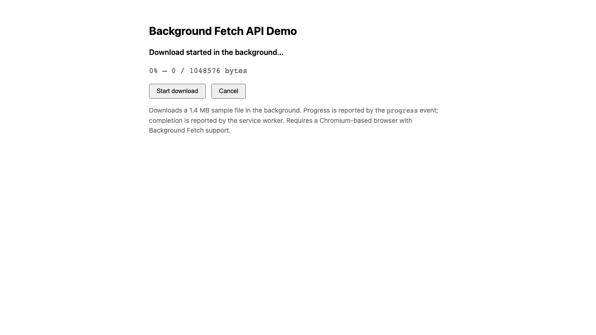

# WebSharper BackgroundFetch API Binding

[](https://www.nuget.org/packages/WebSharper.BackgroundFetch)

This repository provides an F# [WebSharper](https://websharper.com/) binding for the [Background Fetch API](https://developer.mozilla.org/en-US/docs/Web/API/Background_Fetch_API), enabling background downloads of large resources in WebSharper applications.

> **Browser support:** Background Fetch is currently a limited-availability, experimental API. It is implemented in Chromium-based browsers and requires a registered service worker and a secure context (HTTPS or `localhost`). Check [MDN](https://developer.mozilla.org/en-US/docs/Web/API/Background_Fetch_API) for the latest compatibility information.

## Repository structure

The repository contains two projects:

1. **Binding project** (`WebSharper.BackgroundFetch`) — the F# WebSharper binding for the Background Fetch API.
2. **Sample / test case** (`WebSharper.BackgroundFetch.Sample`) — an ASP.NET Core SPA that exercises the binding end to end. It registers a service worker, starts a background download of a bundled 1.4 MB sample file, displays `progress` events, supports cancellation, and handles the service worker's success/failure/abort/click events. See [Running the test case](#running-the-test-case).

## Live demos

**Try it live:** [Open the sample in your browser](https://dotnet-websharper.github.io/BackgroundFetch/)



The sample doubles as the binding's [test case](#running-the-test-case): it exercises the full API surface (service worker registration, background download, progress events, cancellation) in a real browser.

- Binding sample (GitHub Pages): <https://dotnet-websharper.github.io/BackgroundFetch/>
- Source: <https://github.com/dotnet-websharper/BackgroundFetch>
- WebSharper bindings catalog: <https://websharper.com/bindings>

## Installation

```bash
dotnet add package WebSharper.BackgroundFetch
```

## Building

### Prerequisites

- [.NET SDK](https://dotnet.microsoft.com/download) 10.0 or later.

### Steps

1. Clone the repository:

   ```bash
   git clone https://github.com/dotnet-websharper/BackgroundFetch.git
   cd BackgroundFetch
   ```

2. Build the binding project:

   ```bash
   dotnet build WebSharper.BackgroundFetch/WebSharper.BackgroundFetch.fsproj
   ```

3. Build and run the sample:

   ```bash
   cd WebSharper.BackgroundFetch.Sample
   dotnet run
   ```

   Then open the URL printed in the console (by default `http://localhost:61714`).

## Running the test case

The sample doubles as the repository's test case. It covers:

- registering `service-worker.js` and waiting for it to become ready;
- calling `BackgroundFetchManager.Fetch` with a title and `downloadTotal`;
- reading `BackgroundFetchRegistration.Downloaded` / `DownloadTotal` from `progress` events;
- aborting an in-flight download with `BackgroundFetchRegistration.Abort`;
- the service worker's `backgroundfetchsuccess`, `backgroundfetchfail`, `backgroundfetchabort`, and `backgroundfetchclick` events.

Start the sample, click **Start download**, and watch the progress line update. Click **Cancel** to abort an active download. The service worker logs each lifecycle event to the console and shows a notification on success (when notification permission allows it).

## Example usage

Below is a condensed version of the sample. The binding exposes the API as regular .NET types; the service worker is a plain JavaScript file served from the site root.

```fsharp
namespace WebSharper.BackgroundFetch.Sample

open WebSharper
open WebSharper.JavaScript
open WebSharper.UI
open WebSharper.UI.Notation
open WebSharper.UI.Client
open WebSharper.UI.Templating
open WebSharper.BackgroundFetch

[<JavaScript>]
module Client =
    type IndexTemplate = Template<"wwwroot/index.html", ClientLoad.FromDocument>

    let status = Var.Create "Click “Start download” to begin."
    let progress = Var.Create ""

    let getServiceWorkerRegistration () =
        promise {
            let container = JS.Window.Navigator?serviceWorker
            if isNull container then
                status := "Service workers are not supported in this browser."
                return None
            else
                let! _ = container?register("service-worker.js") |> As<Promise<obj>>
                let! registration = container?ready |> As<Promise<obj>>
                return Some registration
        }

    let startBackgroundFetch () =
        promise {
            match! getServiceWorkerRegistration () with
            | None -> ()
            | Some registration ->
                let bgFetch = registration?backgroundFetch |> As<BackgroundFetchManager>
                let options =
                    BackgroundFetchOptions(
                        Title = "WebSharper background fetch demo",
                        DownloadTotal = 1048576.0
                    )
                let! registration =
                    bgFetch.Fetch("websharper-demo", [| "sample-data.txt" |], options)

                status := "Download started in the background…"
                registration.AddEventListener("progress", fun (_: Dom.Event) ->
                    let pct =
                        if registration.DownloadTotal > 0.0 then
                            registration.Downloaded / registration.DownloadTotal * 100.0
                        else 0.0
                    progress := sprintf "%.0f%%" pct
                )
        }

    [<SPAEntryPoint>]
    let Main () =
        IndexTemplate.Main()
            .Status(status.V)
            .Progress(progress.V)
            .startBackgroundFetch(fun _ ->
                async { do! startBackgroundFetch().AsAsync() } |> Async.StartImmediate
            )
            .Doc()
        |> Doc.RunById "main"
```

The companion `service-worker.js` handles the lifecycle events:

```js
self.addEventListener("backgroundfetchsuccess", (event) => {
  const registration = event.registration;
  event.waitUntil((async () => {
    const records = await registration.matchAll();
    for (const record of records) {
      const response = await record.responseReady;
      console.log(record.request.url, response.status);
    }
    await self.registration.showNotification("Background fetch complete", {
      body: `Downloaded ${registration.downloaded} of ${registration.downloadTotal} bytes.`,
    });
  })());
});
```

## Important considerations

- **Service worker required**: the Background Fetch API only works through a registered service worker.
- **Secure context**: it requires HTTPS or `localhost`.
- **Browser support**: limited to Chromium-based browsers today; check MDN for the current matrix.
- **Permissions**: users may be prompted for background operation and notification permissions.

## License

Apache 2.0 — see the [WebSharper core repository](https://github.com/dotnet-websharper/core/blob/master/LICENSE.md).
